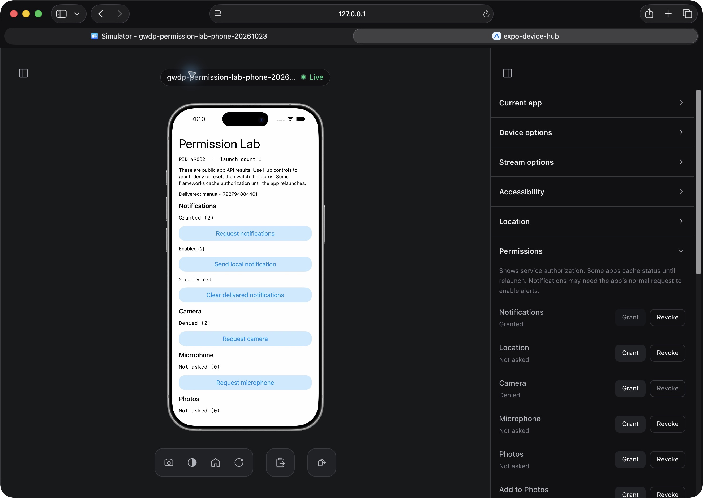

# Device Hub permission controls

Captured by Codex in an owned Safari window on 2026-10-23 from the rebuilt local Hub at port 37794, through the owned-device inventory/input-route adapter. This is a real running iPhone 17 Pro/iOS 26.5 Simulator, not hosted EAS.

The sample public APIs show notifications Granted (2), camera Denied (2), and microphone Not asked (0). The Hub labels match, with Grant disabled for granted notifications and Revoke disabled for denied camera access. The app remains PID 49882, launch count 1.

The screenshot was captured after helper replacement and service readback. Separate deferred-response regressions cover failed replacement reads and independent ownership for equal UDIDs on different hosts. No claim is made that this image proves those failure cases or remote APNs delivery.
