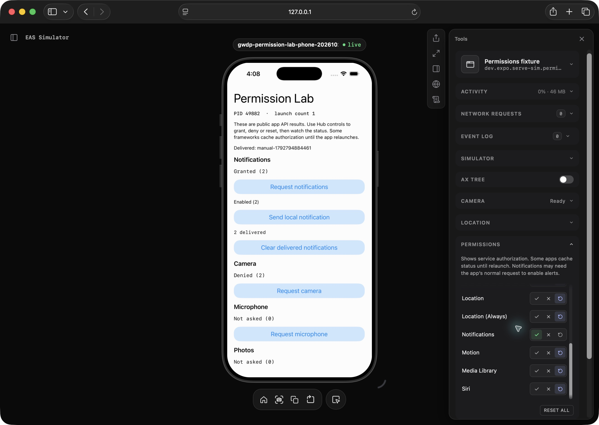

# Standalone preview permission controls

Captured by Codex in an owned Safari window on 2026-10-23 from the rebuilt local serve-sim UI at port 37791, connected to the owned iPhone 17 Pro/iOS 26.5 Simulator.

The open Permissions panel shows Allow/Deny/Reset controls after service readback. Location and Location (Always) have Reset selected for undetermined authorization; Notifications has Allow selected. The sample app independently reports notification authorization Granted (2), PID 49882 and launch count 1.

This is a real browser screenshot of the changed controls. Only presentation sections were collapsed/scrolled for framing; the screenshot is unedited. The known fresh-notification initialization and framework-cache limits still apply. This is local validation, not hosted EAS or remote APNs acceptance.
